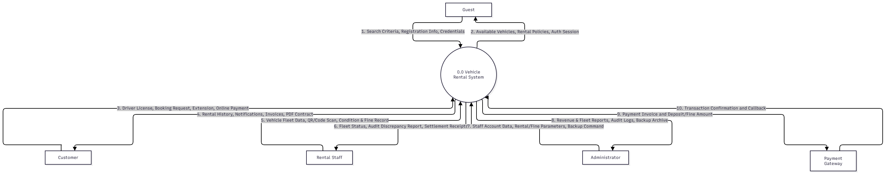
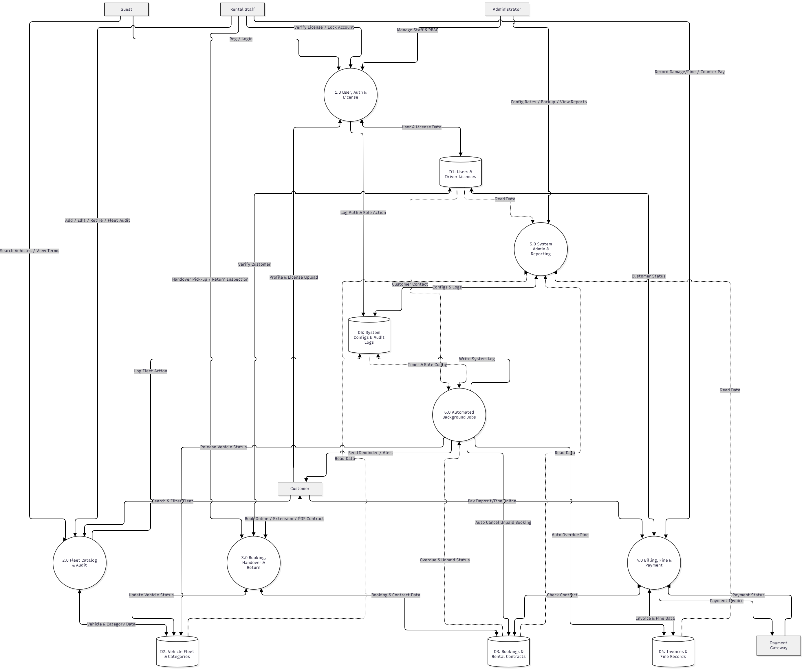
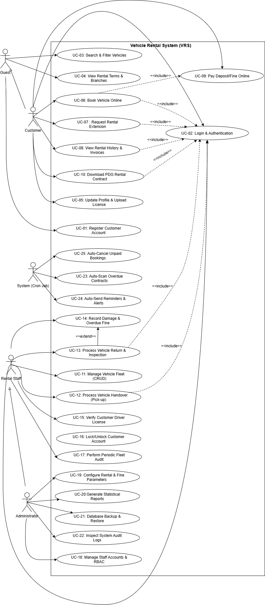
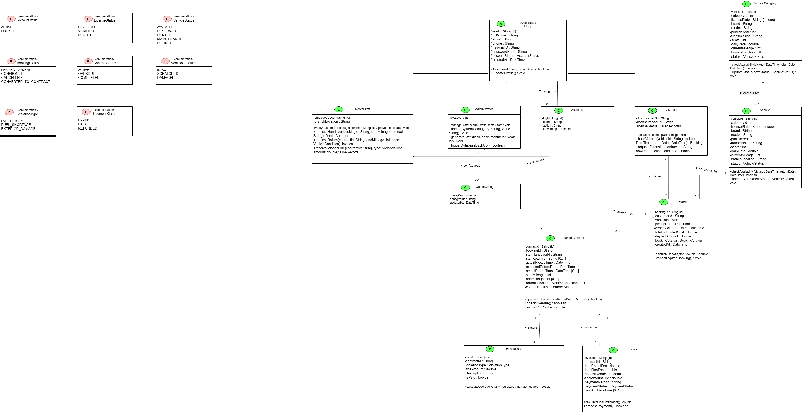
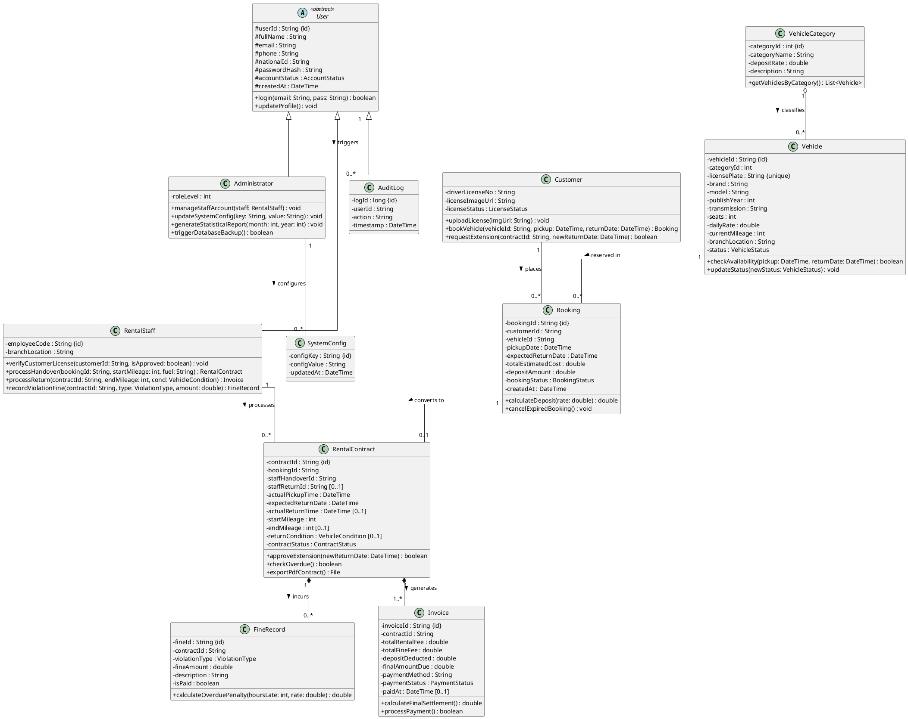
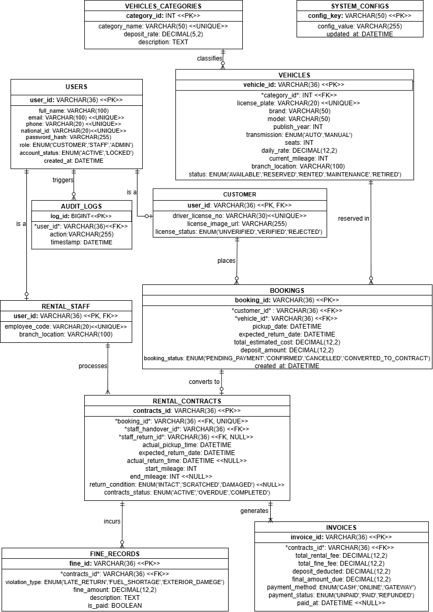
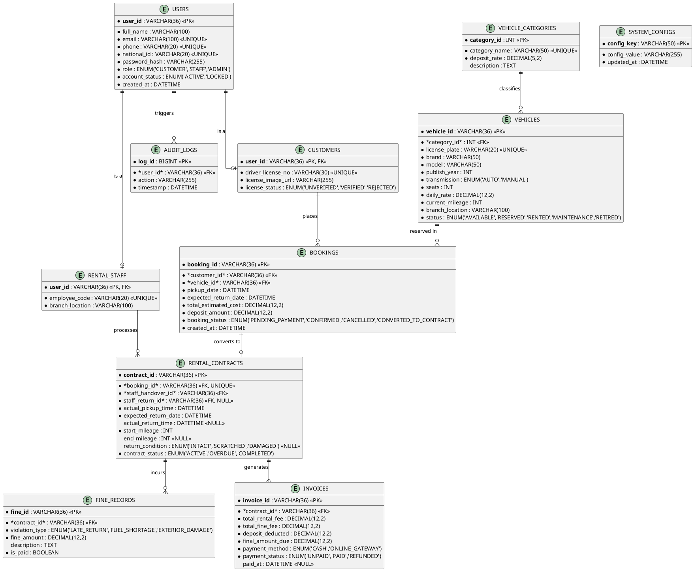

# Software Requirements Specification and Design Document
**Project Name:** Vehicle Rental System (VRS)  

---

## 1. Functional Requirements

### 1.1 Overview
This section lists the functional requirements of the Vehicle Rental System (VRS), grouped by actor.

**Actors**
* **Guest:** A visitor who accesses the system but has not logged in.
* **Customer:** A registered member who has logged in successfully and uploaded a Driver's License. A Customer inherits all Guest functions.
* **Rental Staff:** Showroom staff responsible for physical fleet management, license verification, vehicle handover (pick-up), return inspection, and fine collection.
* **Administrator:** The user with the highest authority, responsible for configuring rental/fine policies, managing staff accounts, and overseeing the whole system.
* **System:** The automatic actor that performs programmed tasks on a schedule or on an event, without direct human action.

**Conventions**
* The word **"shall"** indicates a mandatory requirement.
* Requirement IDs use the format `FR-<ACTOR>-<NN>`.

---

### 1.2 Guest
| ID | Requirement |
| :--- | :--- |
| **FR-GST-01** | The system **shall** allow a Guest to register a Customer account by entering personal information (full name, email, phone number, national ID, and password). The system **shall** validate input data and check for duplicate email, phone number, or national ID before creating the account. |
| **FR-GST-02** | The system **shall** allow a Guest to search and filter public vehicles by brand, category (Car, Motorbike, SUV, Van), transmission type, price range, and pick-up/return dates to see whether a vehicle is available. A Guest **shall not** be able to book or reserve a vehicle without logging in. |
| **FR-GST-03** | The system **shall** allow a Guest to view the showroom's rental terms and conditions, deposit policies, insurance packages, opening hours, and branch locations. |
| **FR-GST-04** | The system **shall** allow a Guest to log in by entering an registered email and password, and **shall** then redirect the user to the role of Customer, Rental Staff, or Administrator according to the account. If the credentials are invalid or the account is locked, the system **shall** display an appropriate error message. |

### 1.3 Customer
| ID | Requirement |
| :--- | :--- |
| **FR-CUS-01** | The system **shall** give a Customer all functions of a Guest (searching vehicles and viewing rental policies). |
| **FR-CUS-02** | The system **shall** allow a Customer to view and update personal information (password, avatar, phone number, address) and upload photos of their Driver's License for staff verification. |
| **FR-CUS-03** | The system **shall** allow a Customer with a verified Driver's License to book an available vehicle online by selecting the pick-up date, expected return date, and optional insurance. The system **shall** prevent booking if the vehicle is already reserved for overlapping dates. |
| **FR-CUS-04** | The system **shall** allow a Customer to send a rental extension request, asking for more rental days, for an active rental contract before its due date. |
| **FR-CUS-05** | The system **shall** approve a rental extension request only if the contract is not currently overdue, the maximum rental duration has not been exceeded, and the vehicle has not been pre-booked by another Customer for the requested extension dates. |
| **FR-CUS-06** | The system **shall** allow a Customer to view their rental history, including currently rented vehicles, completed contracts, scheduled return dates, and the status of their online bookings. |
| **FR-CUS-07** | The system **shall** allow a Customer to view detailed invoices and fine records caused by late returns, fuel shortage, or vehicle damages. |
| **FR-CUS-08** | If the system integrates a bank or e-wallet payment gateway, the system **shall** allow a Customer to pay reservation deposits, rental invoices, and penalty fines online. |
| **FR-CUS-09** | The system **shall** allow a Customer to view and download their signed digital rental contract and payment receipts in PDF format. |

### 1.4 Rental Staff
| ID | Requirement |
| :--- | :--- |
| **FR-STF-01** | The system **shall** allow Rental Staff to add a new vehicle to the fleet catalog (License Plate, Brand, Model, Category, Publish Year, Transmission, Seats, Daily Rate, and Odometer). |
| **FR-STF-02** | The system **shall** allow Rental Staff to edit vehicle information and update daily rental prices. |
| **FR-STF-03** | The system **shall** allow Rental Staff to classify a vehicle by category (Sedan, SUV, Motorbike, Van) and assign its required security deposit rate. |
| **FR-STF-04** | The system **shall** allow Rental Staff to assign the parking bay or showroom branch location of a vehicle. |
| **FR-STF-05** | The system **shall** allow Rental Staff to retire a vehicle or send it to maintenance by updating its status to `MAINTENANCE` or `RETIRED`, temporarily or permanently removing it from public booking. |
| **FR-STF-06** | The system **shall** allow Rental Staff to process a vehicle handover (pick-up) at the showroom by scanning the booking QR/code, recording initial odometer mileage and fuel level, and changing the vehicle status to `RENTED`. |
| **FR-STF-07** | The system **shall** allow Rental Staff to record a returned vehicle by entering its license plate or contract ID, recording final odometer mileage, and updating its status to `AVAILABLE` (or `MAINTENANCE` if damaged). |
| **FR-STF-08** | The system **shall** allow Rental Staff to inspect and record the physical condition of a returned vehicle (`INTACT`, `SCRATCHED`, or `DAMAGED`) and fuel level. |
| **FR-STF-09** | The system **shall** allow Rental Staff to create a violation/damage record with a penalty fine when a Customer returns a vehicle late, returns it with insufficient fuel, or causes exterior/interior damage. |
| **FR-STF-10** | The system **shall** allow Rental Staff to record that an invoice or fine has been settled (or deducted from the security deposit) when the Customer pays at the showroom counter. |
| **FR-STF-11** | The system **shall** allow Rental Staff to review and approve or reject Customer Driver's License verification requests. |
| **FR-STF-12** | The system **shall** allow Rental Staff to lock or unlock a Customer's account according to severe violations of rental regulations or unpaid damages. |
| **FR-STF-13** | The system **shall** allow Rental Staff to perform periodic fleet audits to compare the actual physical vehicles parked in the showroom with the status shown in the software. |

### 1.5 Administrator
| ID | Requirement |
| :--- | :--- |
| **FR-ADM-01** | The system **shall** allow an Administrator to add new Rental Staff accounts, edit their information, or lock them. |
| **FR-ADM-02** | The system **shall** allow an Administrator to define roles and assign specific permissions to them (Role-Based Access Control - RBAC). |
| **FR-ADM-03** | The system **shall** allow an Administrator to configure system parameters: required deposit percentage, maximum rental days, overdue hourly/daily penalty rates, and unpaid booking expiration time. |
| **FR-ADM-04** | The system **shall** allow an Administrator to view and export charts and statistical reports on fleet utilization, monthly rental revenue, new Customers, and total fines collected, by month or by year. |
| **FR-ADM-05** | The system **shall** allow an Administrator to back up the database. |
| **FR-ADM-06** | The system **shall** allow an Administrator to restore the system from a backup when a technical failure occurs. |
| **FR-ADM-07** | The system **shall** allow an Administrator to view system audit logs (recording user login history, vehicle price/status modifications, and configuration changes) for security and auditing purposes. |

### 1.6 System (Automatic Functions)
| ID | Requirement |
| :--- | :--- |
| **FR-SYS-01** | The system **shall** scan all active rental contracts periodically every hour and, for each overdue contract, automatically mark its status as `OVERDUE` and calculate the accrued late fee. |
| **FR-SYS-02** | The system **shall** automatically send reminders to Customers by email, SMS, or in-app notification when a rental contract is due soon (24 hours before the return due time), when a contract becomes overdue, or when a booking is confirmed. |
| **FR-SYS-03** | The system **shall** automatically cancel a `PENDING_PAYMENT` booking if the Customer does not pay the required reservation deposit within 30 minutes of booking creation, and **shall** return the vehicle to the `AVAILABLE` state. |
| **FR-SYS-04** | The system **shall** automatically log critical actions of Rental Staff and Administrators (for example, who approved a license, edited daily rates, or closed a contract) for security and error-tracing purposes. |

---

## 2. Non-Functional Requirements

### 2.1 Overview
This section describes the quality requirements of the Vehicle Rental System (VRS): how well the system shall perform, not what functions it provides. Each requirement is written to be measurable where possible.

**Conventions**
* The word **"shall"** indicates a mandatory requirement.
* Requirement IDs use the format `NFR-<CATEGORY>-<NN>`.
* The numeric values (response times, number of users, and so on) are **proposed targets**.
* The "Related FR" column links a requirement to the functional requirements in Section 1.

---

### 2.2 Performance
| ID | Requirement | Related FR |
| :--- | :--- | :--- |
| **NFR-PER-01** | The system **shall** return available vehicle search and filter results within **2.0 seconds** under normal load for a database containing up to 10,000 vehicle records and 100,000 booking records. | FR-GST-02 |
| **NFR-PER-02** | The system **shall** save a vehicle handover (pick-up) or return transaction and calculate final settlement for Rental Staff within **2.0 seconds** after submission. | FR-STF-06, FR-STF-07 |
| **NFR-PER-03** | The system **shall** support at least **200 concurrent active users** browsing and booking vehicles without more than 10% degradation in average response time. | All |
| **NFR-PER-04** | The periodic background scan of active rental contracts (overdue fee calculation and reminder dispatch) **shall** complete within **5 minutes** without degrading online booking performance. | FR-SYS-01, FR-SYS-02 |
| **NFR-PER-05** | The web application **shall** load its initial catalog interface within **2.5 seconds** for at least 95% of user requests under standard network conditions. | All |

### 2.3 Security
| ID | Requirement | Related FR |
| :--- | :--- | :--- |
| **NFR-SEC-01** | The system **shall** store user passwords using a strong, salted hashing algorithm (e.g., **Bcrypt** with cost factor >= 12 or Argon2) and **shall** never store passwords in plain text. | FR-GST-01, FR-GST-04 |
| **NFR-SEC-02** | The system **shall** encrypt all communication between the user's client browser and the server using **HTTPS over TLS v1.2 or TLS v1.3**. | All |
| **NFR-SEC-03** | The system **shall** enforce Role-Based Access Control (**RBAC**). A user **shall not** be able to access functions or data outside their assigned role permissions, including direct URL manipulation. | FR-ADM-02 |
| **NFR-SEC-04** | A Customer **shall** be restricted to viewing only their own personal profile, uploaded Driver's License, rental contracts, and invoice/fine details. | FR-CUS-02, FR-CUS-06, FR-CUS-07 |
| **NFR-SEC-05** | The system **shall** automatically terminate an idle user session after **30 minutes** of inactivity. | FR-GST-04 |
| **NFR-SEC-06** | The system **shall** temporarily lock an account for **15 minutes** after **5 consecutive failed login attempts** to prevent brute-force attacks. | FR-GST-04 |
| **NFR-SEC-07** | The system **shall** sanitize and validate all user inputs to protect against common web vulnerabilities, including SQL Injection, Cross-Site Scripting (XSS), and CSRF. | All |
| **NFR-SEC-08** | The system audit logs of Rental Staff and Administrator actions **shall** be write-once/read-only (immutable via the application), and **shall** only be viewable by an Administrator. | FR-SYS-04, FR-ADM-07 |
| **NFR-SEC-09** | The system **shall not** store any raw credit card, bank, or e-wallet credentials. All online deposit and fine payments **shall** be delegated securely to third-party payment gateways. | FR-CUS-08 |
| **NFR-SEC-10** | Uploaded sensitive identity documents (National ID and Driver's License images) **shall** be stored in private storage buckets accessible only to authenticated Rental Staff and Administrators. | FR-CUS-02, FR-STF-11 |

### 2.4 Reliability, Availability, and Data Integrity
| ID | Requirement | Related FR |
| :--- | :--- | :--- |
| **NFR-REL-01** | The system **shall** maintain an uptime availability of at least **99.5%** during operational hours, excluding scheduled maintenance windows. | All |
| **NFR-REL-02** | The system **shall** enforce transactional **ACID** properties. If a booking payment, handover, or return transaction fails midway, the system **shall** perform an automatic rollback to prevent inconsistent vehicle statuses. | FR-CUS-03, FR-STF-06, FR-STF-07 |
| **NFR-REL-03** | The system **shall** implement database concurrency control (e.g., **pessimistic row-level locking**) to prevent race conditions and ensure **zero double-bookings** when two Customers attempt to book the exact same vehicle for overlapping dates simultaneously. | FR-CUS-03 |
| **NFR-REL-04** | The system **shall** perform automated daily database backups at **00:00** and store copies in two physically isolated locations (local backup server and cloud storage). | FR-ADM-05 |
| **NFR-REL-05** | Following a hardware or system failure, the system **shall** achieve a Recovery Time Objective (**RTO**) of <= 4 hours and a Recovery Point Objective (**RPO**) of <= 24 hours. | FR-ADM-06 |
| **NFR-REL-06** | The system **shall** handle email/SMS notification dispatching asynchronously with automated retry mechanisms, ensuring that notification delivery failures do not block core booking transactions. | FR-SYS-02 |

### 2.5 Usability
| ID | Requirement | Related FR |
| :--- | :--- | :--- |
| **NFR-USA-01** | The primary user interface language **shall** be Vietnamese (with English support), using **UTF-8** character encoding across all displays, forms, and database transactions. | All |
| **NFR-USA-02** | A newly recruited Rental Staff member **shall** be able to perform standard vehicle handover and return inspections without supervision after at most **4 hours** of system training. | FR-STF-06, FR-STF-07 |
| **NFR-USA-03** | The system **shall** display clear, actionable, and non-technical error messages (e.g., *"This vehicle is already booked from 10/11 to 12/11"*) rather than raw system exceptions. | All |
| **NFR-USA-04** | The public portal (Guest and Customer interfaces) **shall** feature a responsive design that displays correctly across major desktop and mobile browsers down to a viewport width of **360px**. | FR-GST-02, FR-CUS-03, FR-CUS-06 |
| **NFR-USA-05** | The system **shall** require explicit user confirmation via modal dialogs before executing non-reversible or destructive actions (e.g., retiring a vehicle, locking a customer account, or modifying penalty rates). | FR-STF-05, FR-STF-12, FR-ADM-01, FR-ADM-03 |

### 2.6 Compatibility and Localization
| ID | Requirement | Related FR |
| :--- | :--- | :--- |
| **NFR-COM-01** | The web application **shall** be fully compatible with the latest two major stable versions of Google Chrome, Microsoft Edge, Mozilla Firefox, and Apple Safari on both desktop and mobile platforms. | All |
| **NFR-COM-02** | The system **shall** interface seamlessly with standard optical/USB QR and barcode scanners for scanning booking codes and Customer IDs at the showroom counter. | FR-STF-06, FR-STF-13 |
| **NFR-COM-03** | The system **shall** fully support Vietnamese localization (L10n), formatting dates as `DD/MM/YYYY`, displaying currency in `VND`, and synchronizing timestamps with Indochina Time (`UTC+7`). | All |
| **NFR-COM-04** | The contract management component **shall** support generating and downloading rental contracts and invoices in standard **PDF** file format. | FR-CUS-09 |

### 2.7 Maintainability and Scalability
| ID | Requirement | Related FR |
| :--- | :--- | :--- |
| **NFR-MNT-01** | The system architecture **shall** follow a modular design (**3-Tier / MVC Architecture**) ensuring low coupling and high cohesion, so that modifications in one module (e.g., Auth, Fleet, Booking, Billing) do not impact others. | All |
| **NFR-MNT-02** | Global business parameters (deposit percentage, maximum rental duration, overdue fine rates) **shall** be dynamically configurable via the Administrator interface without requiring source code modifications or system redeployment. | FR-ADM-03 |
| **NFR-MNT-03** | The codebase **shall** adhere strictly to established coding standards, maintain inline documentation, and provide clean API specifications to facilitate onboarding for team members. | All |
| **NFR-MNT-04** | The database schema and indexing strategy **shall** be designed to scale seamlessly, supporting at least **10,000 vehicles**, **50,000 Customer accounts**, and up to **500,000 booking/contract logs** without architectural redesign. | All |

---

## 3. Data Flow Diagram (DFD)

### 3.1 Context Diagram (Level 0 DFD)
The Context Diagram defines the system boundary of the Vehicle Rental System (VRS), illustrating the central system (`0.0`) and its high-level data exchanges with external entities.

#### External Entities
- **Guest**: Unauthenticated visitors who browse the public vehicle catalog, view rental terms and showroom locations, or register/log in.
- **Customer**: Authenticated members with verified Driver's Licenses who book vehicles online, request rental extensions, view rental history/invoices, download digital PDF contracts, and pay deposits or fines online.
- **Rental Staff**: Showroom personnel managing fleet cataloging, Driver's License verification, counter vehicle handover (pick-up) and return inspections, periodic fleet audits, and damage/overdue violation records.
- **Administrator**: System managers configuring rental/fine parameters, managing staff accounts and RBAC permissions, backing up/restoring databases, and inspecting statistical reports and audit logs.
- **Payment Gateway**: External third-party financial service handling online reservation deposit, rental invoice, and penalty fine payments.

#### Context Diagram

---

### 3.2 List of Data Stores
The system relies on five persistent data stores to maintain data integrity and support all functional requirements defined in Section 1:

| Store ID | Data Store Name | Description | Related FRs |
| :--- | :--- | :--- | :--- |
| **D1** | **Users & Driver Licenses** | Stores user credentials, personal profiles, assigned RBAC roles/permissions, account statuses (`ACTIVE`, `LOCKED`), and uploaded Driver's License verification records. | FR-GST-01, FR-GST-04, FR-CUS-02, FR-STF-11, FR-STF-12, FR-ADM-01, FR-ADM-02, FR-ADM-04 (read) |
| **D2** | **Vehicle Fleet & Categories** | Stores vehicle specifications (License Plate, Brand, Model, Year, Transmission, Seats, Daily Rate, Odometer), categories, deposit rates, branch locations, and status (`AVAILABLE`, `RESERVED`, `RENTED`, `MAINTENANCE`, `RETIRED`). | FR-GST-02, FR-GST-03, FR-CUS-01, FR-STF-01 to FR-STF-05, FR-STF-13, FR-ADM-04 (read) |
| **D3** | **Bookings & Rental Contracts** | Stores online reservation records, pick-up/return timestamps, start/end odometer readings, returned vehicle conditions (`INTACT`, `SCRATCHED`, `DAMAGED`), extension requests, and PDF digital contracts. | FR-CUS-03 to FR-CUS-06, FR-CUS-09, FR-STF-06 to FR-STF-08, FR-SYS-03, FR-ADM-04 (read) |
| **D4** | **Invoices & Fine Records** | Stores rental invoices, deposit deductions, violation tickets (late return, fuel shortage, exterior/interior damage), calculated penalty amounts, and counter/online payment statuses. | FR-CUS-07, FR-CUS-08, FR-STF-09, FR-STF-10, FR-SYS-01, FR-ADM-04 (read) |
| **D5** | **System Configs & Audit Logs** | Stores global operational settings (deposit percentage, max rental days, overdue fine rates, booking expiration time), backup metadata, and immutable system audit logs. | FR-ADM-03, FR-ADM-05 to FR-ADM-07, FR-SYS-02, FR-SYS-04 |

---

### 3.3 Level 1 DFD (Subsystem Decomposition)
The central process (`0.0`) is decomposed into **6 core functional processes**:

#### Detailed Process Descriptions

##### Process 1.0: User, Authentication & License Management
* **Description:** Handles customer account registration, login authentication, personal profile updates, Driver's License photo uploads and staff verification, customer account locking/unlocking, and staff RBAC permission management.
* **Inputs:** Registration forms, login credentials, profile & license uploads, license approval/lock commands, staff/role assignments.
* **Outputs:** Authentication session/tokens, profile & verification status views, account status updates.
* **Data Stores:** Reads/Writes **D1 (Users & Driver Licenses)**, Writes **D5 (System Configs & Audit Logs)**.

##### Process 2.0: Fleet Catalog & Inventory Audit Management
* **Description:** Manages adding new vehicles, editing specifications and daily rental rates, vehicle category & deposit classification, showroom branch assignment, vehicle retirement/maintenance status, periodic physical fleet audits, and public vehicle searching/filtering.
* **Inputs:** Search & date filter criteria, vehicle metadata, daily rates, parking branch locations, maintenance/retirement commands, physical fleet audit scans.
* **Outputs:** Available vehicle search results, rental policy views, fleet discrepancy reports.
* **Data Stores:** Reads/Writes **D2 (Vehicle Fleet & Categories)**, Writes **D5 (System Configs & Audit Logs)**.

##### Process 3.0: Booking, Handover & Return Operations
* **Description:** Processes online vehicle bookings (preventing overlapping double-bookings), evaluates rental extension requests, records showroom vehicle handover (pick-up) and return inspections (odometer mileage, fuel level, exterior/interior condition), and generates downloadable PDF contracts.
* **Inputs:** Online booking requests, rental extension requests, booking QR/code scans, start/end odometer readings, returned vehicle condition (`INTACT`, `SCRATCHED`, `DAMAGED`).
* **Outputs:** Booking confirmations, digital PDF rental contracts, handover agreements, updated vehicle statuses (`RESERVED`, `RENTED`, `AVAILABLE`, `MAINTENANCE`), extension approvals/rejections.
* **Data Stores:** Reads **D1**, Reads/Writes **D2**, Reads/Writes **D3 (Bookings & Rental Contracts)**.

##### Process 4.0: Billing, Fine Management & Payment Processing
* **Description:** Creates violation/damage fine records (late return, fuel shortage, vehicle damage), computes final contract settlement (deducting fines from security deposits), records showroom counter payments, and integrates with the Payment Gateway for online deposit/invoice/fine payments.
* **Inputs:** Damage/violation tickets, counter payment confirmations, online payment gateway callbacks.
* **Outputs:** Itemized invoices and fine statements, payment receipts, updated booking/contract settlement statuses.
* **Data Stores:** Reads **D3**, Reads/Writes **D4 (Invoices & Fine Records)**, Reads/Writes **D1**.

##### Process 5.0: System Administration, Audit & Reporting
* **Description:** Enables administrators to configure global rental/fine parameters, generate and export analytical charts/reports (fleet utilization, revenue, fines), execute database backups and restores, and inspect system audit logs.
* **Inputs:** Policy parameter values, report date/type filters, database backup/restore commands.
* **Outputs:** Exported PDF/Excel statistical reports, configuration confirmations, database backup archives, audit log views.
* **Data Stores:** Reads **D1, D2, D3, D4**; Reads/Writes **D5 (System Configs & Audit Logs)**.

##### Process 6.0: Automated Background Services
* **Description:** Executes scheduled background tasks (e.g., hourly overdue contract scanning and 30-minute unpaid booking expiration checks) to calculate accrued overdue fees, send due/overdue/booking notifications, cancel unpaid reservations, and log automated actions.
* **Inputs:** Scheduled timer triggers and penalty rates from **D5**, active contract and pending booking statuses from **D3**, customer contact details from **D1**.
* **Outputs:** Automated overdue fine entries, email/SMS/in-app notifications to Customers, canceled unpaid bookings and released vehicle statuses, system log entries.
* **Data Stores:** Reads **D1**, Reads/Writes **D2**, Reads/Writes **D3**, Reads/Writes **D4**, Reads/Writes **D5**.

---

## 4. Use Case Diagram

### 4.1 System Use Case Diagram
The Use Case Diagram illustrates the interactions between the system actors (`Guest`, `Customer`, `Rental Staff`, `Administrator`, and `System`) and the 25 use cases of the Vehicle Rental System (VRS), mapped directly to all functional requirements in Section 1.

---

### 4.2 Actor & Use Case Catalogue

#### 4.2.1 List of Actors
| No. | Actor Name | Description |
| :--- | :--- | :--- |
| 1 | **Guest** | Unauthenticated visitor who can browse the vehicle catalog, check rental terms/branch locations, register a new account, and log in. |
| 2 | **Customer** | Authenticated user with a verified Driver's License who can book vehicles online, request extensions, view rental history/invoices, download PDF contracts, and pay deposits/fines online. Inherits all Guest capabilities. |
| 3 | **Rental Staff** | Showroom employee responsible for managing the vehicle fleet, verifying customer licenses, processing vehicle handover (pick-up) and return inspections, recording damages/fines, and auditing physical inventory. |
| 4 | **Administrator** | System manager with the highest authority, responsible for staff accounts and RBAC permissions, system parameter configuration, statistical reports, database backups, and audit logs. Inherits Staff capabilities. |
| 5 | **System (Cron Job)** | Automated background scheduler that scans overdue contracts hourly, sends email/SMS reminders, and cancels expired unpaid bookings. |

#### 4.2.2 Use Case Traceability Matrix
| Use Case ID | Use Case Name | Primary Actor | Related FRs |
| :--- | :--- | :--- | :--- |
| **UC-01** | Register Customer Account | Guest | FR-GST-01 |
| **UC-02** | Login & Authentication | Guest, Customer, Staff, Admin | FR-GST-04 |
| **UC-03** | Search & Filter Vehicles | Guest, Customer, Staff | FR-GST-02, FR-CUS-01 |
| **UC-04** | View Rental Terms & Branches | Guest, Customer | FR-GST-03, FR-CUS-01 |
| **UC-05** | Update Profile & Upload License | Customer | FR-CUS-02 |
| **UC-06** | Book Vehicle Online | Customer | FR-CUS-03 |
| **UC-07** | Request Rental Extension | Customer | FR-CUS-04, FR-CUS-05 |
| **UC-08** | View Rental History & Invoices | Customer | FR-CUS-06, FR-CUS-07 |
| **UC-09** | Pay Deposit/Fine Online | Customer | FR-CUS-08 |
| **UC-10** | Download PDF Rental Contract | Customer | FR-CUS-09 |
| **UC-11** | Manage Vehicle Fleet (CRUD) | Rental Staff | FR-STF-01 to FR-STF-05 |
| **UC-12** | Process Vehicle Handover (Pick-up) | Rental Staff | FR-STF-06 |
| **UC-13** | Process Vehicle Return & Inspection | Rental Staff | FR-STF-07, FR-STF-08 |
| **UC-14** | Record Damage & Overdue Fine | Rental Staff | FR-STF-09, FR-STF-10 |
| **UC-15** | Verify Customer Driver License | Rental Staff | FR-STF-11 |
| **UC-16** | Lock/Unlock Customer Account | Rental Staff | FR-STF-12 |
| **UC-17** | Perform Periodic Fleet Audit | Rental Staff | FR-STF-13 |
| **UC-18** | Manage Staff Accounts & RBAC | Administrator | FR-ADM-01, FR-ADM-02 |
| **UC-19** | Configure Rental & Fine Parameters | Administrator | FR-ADM-03 |
| **UC-20** | Generate Statistical Reports | Administrator | FR-ADM-04 |
| **UC-21** | Database Backup & Restore | Administrator | FR-ADM-05, FR-ADM-06 |
| **UC-22** | Inspect System Audit Logs | Administrator | FR-ADM-07, FR-SYS-04 |
| **UC-23** | Auto-Scan Overdue Contracts | System | FR-SYS-01 |
| **UC-24** | Auto-Send Reminders & Alerts | System | FR-SYS-02 |
| **UC-25** | Auto-Cancel Unpaid Bookings | System | FR-SYS-03 |

---

### 4.3 Detailed Use Case Specifications (Core Use Cases)

To guide software implementation (Stage 3) and test case creation (Stage 4), the detailed specifications for the core use cases are provided below.

#### 1. UC-03: Search & Filter Vehicles
* **Summary:** Allows users to search and filter public vehicles by brand, category, transmission, price range, and pick-up/return dates to check availability.
* **Primary Actor:** Guest / Customer / Rental Staff.
* **Preconditions:** The system database is online and vehicle catalog data is initialized.
* **Postconditions:** Matching available vehicles are displayed to the user; system state remains unchanged.
* **Main Flow:**
  1. The user navigates to the Vehicle Catalog search page.
  2. The user enters search criteria (Pick-up Date, Expected Return Date, Vehicle Category, Brand, Transmission, or Price Range) and clicks **"Search"**.
  3. The system validates that the Pick-up Date is not in the past and the Return Date is later than the Pick-up Date.
  4. The system queries the database, filtering out vehicles in `MAINTENANCE` or `RETIRED` status and excluding vehicles with overlapping active bookings/contracts.
  5. The system displays a paginated list of matching available vehicles with daily rental rates and specifications.
  6. The user selects a vehicle card to view detailed photos, required security deposit rate, and showroom branch location.
* **Alternative / Exception Flows:**
  * **3a. Invalid Date Range:** If the Return Date is earlier than the Pick-up Date, the system highlights the date fields and displays an error message: *"Return date must be later than pick-up date."*
  * **5a. No Matching Vehicles:** If no vehicles match the filter criteria, the system displays *"No available vehicles found for the selected dates"* and suggests clearing filters.
* **Special Requirements:** Search response time shall not exceed 2.0 seconds (`NFR-PER-01`).

#### 2. UC-06: Book Vehicle Online
* **Summary:** Allows an authenticated Customer with a verified Driver's License to reserve an available vehicle online and pay the reservation deposit.
* **Primary Actor:** Customer.
* **Included Use Cases:** `UC-02 (Login & Authentication)`, `UC-09 (Pay Deposit/Fine Online)`.
* **Preconditions:** Customer is logged in, account status is `ACTIVE`, and Driver's License status is `VERIFIED`.
* **Postconditions:** If successful, a `CONFIRMED` booking record is saved, deposit payment is recorded, and the vehicle is reserved for the selected date range.
* **Main Flow:**
  1. Customer views an available vehicle's detail page, selects Pick-up Date, Expected Return Date, and optional insurance, and clicks **"Book Now"**.
  2. System checks Customer eligibility (`ACTIVE` account, `VERIFIED` license, no unpaid overdue fines).
  3. System acquires a pessimistic row-level database lock (`NFR-REL-03`) on the vehicle record to verify zero overlapping reservations.
  4. System calculates total rental days, estimated rental fee, and required reservation deposit, then creates a booking with status `PENDING_PAYMENT`.
  5. System redirects the Customer to the Payment Gateway (`<<include>> UC-09`).
  6. Customer completes the online deposit payment within 30 minutes.
  7. System updates the booking status to `CONFIRMED`, updates the vehicle status to `RESERVED`, and sends a booking confirmation receipt with a QR code.
* **Alternative / Exception Flows:**
  * **2a. Unverified Driver's License:** If the Customer's license is `UNVERIFIED` or `REJECTED`, the system blocks the booking and redirects the Customer to upload a valid Driver's License (`UC-05`).
  * **3a. Concurrency Conflict:** If another Customer simultaneously booked the vehicle for overlapping dates, the system aborts the transaction and notifies the Customer that the vehicle is no longer available.
  * **6a. Payment Timeout:** If the Customer fails to pay the deposit within 30 minutes, the automated background job (`UC-25`) cancels the booking (`CANCELLED`) and releases the vehicle back to `AVAILABLE`.

#### 3. UC-11: Manage Vehicle Fleet (CRUD)
* **Summary:** Allows Rental Staff to add new vehicles, update vehicle details and daily rental prices, assign categories/branches, or retire/send vehicles to maintenance.
* **Primary Actor:** Rental Staff.
* **Preconditions:** Rental Staff is logged in with valid staff permissions.
* **Postconditions:** Vehicle fleet records in the database are added, updated, or retired, and an audit log entry is recorded.
* **Main Flow:**
  1. Rental Staff selects the **"Fleet Management"** menu; the system displays the paginated vehicle fleet list.
  2. **Add Vehicle Sub-flow:** Staff clicks **"Add New Vehicle"**, enters License Plate, Brand, Model, Category, Publish Year, Transmission, Seats, Daily Rate, Odometer, and Branch Location, and clicks **"Save"**. The system validates uniqueness of the License Plate and creates the record with `AVAILABLE` status.
  3. **Update Vehicle Sub-flow:** Staff selects an existing vehicle, modifies its specifications, daily rate, or branch location, and clicks **"Update"**. The system validates the data and saves changes.
  4. **Retire / Maintenance Sub-flow:** Staff selects a vehicle and changes its status to `MAINTENANCE` or `RETIRED`. The system asks for confirmation (`NFR-USA-05`) and removes the vehicle from public booking availability.
* **Alternative / Exception Flows:**
  * **2a. Duplicate License Plate:** If the entered License Plate already exists in the database, the system rejects creation and displays an error message.
  * **4a. Vehicle Currently Rented:** If Staff attempts to retire a vehicle whose status is currently `RENTED` or `RESERVED`, the system blocks the action until active contracts/bookings are completed.

#### 4. UC-12: Process Vehicle Handover (Pick-up)
* **Summary:** Allows Rental Staff to hand over a reserved vehicle to a Customer at the showroom counter and activate the rental contract.
* **Primary Actor:** Rental Staff.
* **Preconditions:** Rental Staff is logged in; Customer arrives at the showroom with a `CONFIRMED` booking QR code and original Driver's License / National ID.
* **Postconditions:** A new `RentalContract` is activated (`ACTIVE`), initial vehicle metrics are saved, and vehicle status becomes `RENTED`.
* **Main Flow:**
  1. Rental Staff opens the **"Vehicle Handover"** screen and scans the Customer's booking QR code (or enters Booking ID).
  2. System retrieves booking details, Customer profile, and assigned vehicle information.
  3. Rental Staff physically inspects and verifies the Customer's original Driver's License and National ID.
  4. Rental Staff inspects the vehicle with the Customer and inputs the initial odometer reading (`start_mileage`), fuel level, and exterior condition notes into the form.
  5. Rental Staff clicks **"Confirm Handover"**.
  6. System creates an active `RentalContract` (`ACTIVE`), updates the booking status to `CONVERTED_TO_CONTRACT`, updates the vehicle status from `RESERVED` to `RENTED`, and generates a downloadable PDF contract (`UC-10`).
* **Exception Flow:**
  * **3a. Invalid Identification Documents:** If the Customer fails to present valid original identification documents, Rental Staff rejects the handover and cancels the booking according to showroom policy.

#### 5. UC-13: Process Vehicle Return & Inspection
* **Summary:** Allows Rental Staff to record a returned vehicle, inspect its physical condition and odometer reading, and settle the rental contract.
* **Primary Actor:** Rental Staff.
* **Extended Use Case:** `UC-14 (Record Damage & Overdue Fine)`.
* **Preconditions:** Rental Staff is logged in; the vehicle is currently in `RENTED` status under an `ACTIVE` or `OVERDUE` contract.
* **Postconditions:** Contract status is updated to `COMPLETED`, final invoice is settled, and vehicle status is updated to `AVAILABLE` or `MAINTENANCE`.
* **Main Flow:**
  1. Rental Staff opens the **"Process Return"** screen and enters the vehicle's License Plate or Contract ID.
  2. System retrieves the active `RentalContract`, displaying scheduled return time, initial odometer reading (`start_mileage`), and paid deposit amount.
  3. Rental Staff inspects the returned vehicle and inputs the actual return timestamp, final odometer reading (`end_mileage`), fuel level, and physical condition (`INTACT`, `SCRATCHED`, or `DAMAGED`).
  4. System compares the actual return time with the scheduled due date and checks the inspection condition.
  5. If returned on time, with sufficient fuel, and in `INTACT` condition, the system calculates the final balance (deducting the paid deposit).
  6. Customer pays the remaining rental balance (or receives deposit refund) at the counter; Rental Staff clicks **"Complete Return"**.
  7. System marks the contract as `COMPLETED`, marks the invoice as `PAID`, and updates the vehicle's `current_mileage` and status to `AVAILABLE`.
* **Extension Point (`<<extend>> UC-14: Record Damage & Overdue Fine`):**
  * **5a. Violation Detected:** If the vehicle is returned past the due date, has insufficient fuel, or its condition is `SCRATCHED` / `DAMAGED`, the system triggers **UC-14** to calculate overdue penalty fees and repair costs, adds them to the final invoice, and sets the vehicle status to `MAINTENANCE` (if damaged) before closing the contract.

## 5. Class Diagram & Software Architecture Design

### 5.1 Software Architecture Design (Stage 2 Requirement)
To satisfy the maintainability and scalability requirements (`NFR-MNT-01` to `NFR-MNT-04`), the Vehicle Rental System (VRS) is designed using a **3-Tier Architecture** combined with the **Model-View-Controller (MVC)** and **Repository Design Pattern**:

1. **Presentation Tier (View Layer):**
   * **Responsibility:** Renders the responsive Graphical User Interface (GUI) for Guests, Customers, Rental Staff, and Administrators (`NFR-USA-04`).
   * **Components:** Public Vehicle Catalog Views, Customer Booking & Profile Dashboards, Showroom Handover/Return Counter Forms (supporting QR/barcode scanner inputs per `NFR-COM-02`), and Admin Analytical Dashboards.
2. **Business Logic Tier (Controller & Service Layer):**
   * **Responsibility:** Processes HTTP requests from the View layer, enforces Role-Based Access Control (`NFR-SEC-03`), validates business rules, and executes scheduled background cron jobs (`FR-SYS-01` to `FR-SYS-04`).
   * **Core Services:** `AuthService` (Bcrypt hashing & JWT session control), `FleetService` (vehicle CRUD & audit), `BookingService` (pessimistic locking to prevent double-booking per `NFR-REL-03`), `ContractService` (handover, return inspection, extension validation, and PDF generation), and `BillingService` (deposit/fine calculation and Payment Gateway integration).
3. **Data Access Tier (Repository & Model Layer):**
   * **Responsibility:** Abstracts database operations using the Repository Pattern, enforces ACID transactions (`NFR-REL-02`), and maps domain entities to relational database tables.

---

### 5.2 System Domain Class Diagram
The Class Diagram models the static object-oriented structure of the Vehicle Rental System, including domain classes, attributes, operations, enumerations, and class relationships.

View PlantUML Source Code (Class Diagram)

---

### 5.3 Explanation of Classes and Relationships

* **Generalization (Inheritance - `<|--`):**
  * The abstract base class `User` encapsulates shared identity and authentication attributes (`userId`, `fullName`, `email`, `phone`, `nationalId`, `passwordHash`, `accountStatus`).
  * `Customer`, `RentalStaff`, and `Administrator` inherit from `User` and extend role-specific attributes and operations (`FR-GST-04`, `FR-ADM-01`, `FR-ADM-02`).
* **Aggregation (`o--`):**
  * `VehicleCategory "1" o-- "0..*" Vehicle`: A category (e.g., Sedan, SUV, Motorbike) groups multiple vehicles (`FR-STF-03`). Vehicles can exist independently and be reassigned if a category is reorganized.
* **Composition (`*--`):**
  * `RentalContract "1" *-- "0..*" FineRecord` and `RentalContract "1" *-- "1..*" Invoice`: Fine records and settlement invoices are strictly bound to the lifecycle of a specific `RentalContract` (`FR-CUS-07`, `FR-STF-09`, `FR-STF-10`).
* **Association (`--`):**
  * `Customer "1" -- "0..*" Booking` and `Vehicle "1" -- "0..*" Booking`: Links a Customer and a Vehicle through an online reservation (`FR-CUS-03`).
  * `Booking "1" -- "0..1" RentalContract`: When the Customer picks up the vehicle at the showroom (`FR-STF-06`), a confirmed `Booking` transitions into an active `RentalContract`.
  * `User "1" -- "0..*" AuditLog` and `Administrator "1" -- "0..*" SystemConfig`: Tracks immutable security logs (`FR-SYS-04`, `FR-ADM-07`) and dynamic system parameters (`FR-ADM-03`).

## 6. Data Model

### 6.1 Mapping Rules from Class Diagram to Relational Database
Following the software engineering principles for converting an Object-Oriented Class Diagram into a Relational Database Schema, the database tables are derived using four mapping rules:
1. **Inheritance Mapping (Joined Subclass Strategy):** The abstract class `User` is mapped to the base table `USERS` (`user_id` PK). Role-specific subclasses (`Customer` and `RentalStaff`) are mapped to `CUSTOMERS` and `RENTAL_STAFF` tables, where `user_id` serves as both the Primary Key (PK) and Foreign Key (FK) referencing `USERS(user_id)`.
2. **One-to-Many (`1:N`) Relationships (Reference Key Strategy):** The Primary Key of the "1" side is placed as a Foreign Key in the "N" side table (e.g., `category_id` in `VEHICLES`, `customer_id` and `vehicle_id` in `BOOKINGS`, `contract_id` in `FINE_RECORDS` and `INVOICES`).
3. **One-to-One (`1:1`) Lifecycle Relationship:** The `1..1` to `0..1` transition between `Booking` and `RentalContract` is mapped by placing `booking_id` in `RENTAL_CONTRACTS` with both a `FOREIGN KEY` and a `UNIQUE` constraint.
4. **System & Security Auditing Tables:** `SYSTEM_CONFIGS` and `AUDIT_LOGS` are included to satisfy dynamic configuration (`FR-ADM-03`, `NFR-MNT-02`) and immutable security logging (`FR-SYS-04`, `NFR-SEC-08`).

---

### 6.2 Entity-Relationship Diagram (ERD / Relational Schema)

View PlantUML Source Code (ERD Diagram)

---

### 6.3 Database Schema & Data Dictionary

#### 6.3.1 Table `USERS` (Base User Accounts)
| Column Name | Data Type | Constraints | Key | Description |
| :--- | :--- | :--- | :--- | :--- |
| `user_id` | VARCHAR(36) | NOT NULL | **PK** | Unique UUID identifier for each user. |
| `full_name` | VARCHAR(100) | NOT NULL | | Full legal name of the user. |
| `email` | VARCHAR(100) | NOT NULL, UNIQUE | | Login email address (`FR-GST-01`). |
| `phone` | VARCHAR(20) | NOT NULL, UNIQUE | | Contact phone number for SMS alerts. |
| `national_id` | VARCHAR(20) | NOT NULL, UNIQUE | | Citizen ID / Passport number. |
| `password_hash` | VARCHAR(255) | NOT NULL | | Salted Bcrypt password hash (`NFR-SEC-01`). |
| `role` | ENUM | NOT NULL | | `'CUSTOMER'`, `'STAFF'`, or `'ADMIN'` (`FR-ADM-02`). |
| `account_status` | ENUM | DEFAULT `'ACTIVE'` | | `'ACTIVE'` or `'LOCKED'` (`FR-STF-12`). |
| `created_at` | DATETIME | DEFAULT CURRENT_TIMESTAMP | | Account registration timestamp. |

#### 6.3.2 Table `CUSTOMERS` (Customer Driver's License Profile)
| Column Name | Data Type | Constraints | Key | Description |
| :--- | :--- | :--- | :--- | :--- |
| `user_id` | VARCHAR(36) | NOT NULL | **PK, FK** | References `USERS(user_id)` on delete cascade. |
| `driver_license_no` | VARCHAR(30) | UNIQUE, NULLABLE | | Driver's license number (`FR-CUS-02`). |
| `license_image_url` | VARCHAR(255) | NULLABLE | | Private storage path to license photo (`NFR-SEC-10`). |
| `license_status` | ENUM | DEFAULT `'UNVERIFIED'` | | `'UNVERIFIED'`, `'VERIFIED'`, or `'REJECTED'` (`FR-STF-11`). |

#### 6.3.3 Table `RENTAL_STAFF` (Showroom Staff Profile)
| Column Name | Data Type | Constraints | Key | Description |
| :--- | :--- | :--- | :--- | :--- |
| `user_id` | VARCHAR(36) | NOT NULL | **PK, FK** | References `USERS(user_id)`. |
| `employee_code` | VARCHAR(20) | NOT NULL, UNIQUE | | Internal staff identification code (`FR-ADM-01`). |
| `branch_location` | VARCHAR(100) | NOT NULL | | Assigned showroom branch. |

#### 6.3.4 Table `VEHICLE_CATEGORIES` (Fleet Classification)
| Column Name | Data Type | Constraints | Key | Description |
| :--- | :--- | :--- | :--- | :--- |
| `category_id` | INT | AUTO_INCREMENT | **PK** | Unique identifier for vehicle category. |
| `category_name` | VARCHAR(50) | NOT NULL, UNIQUE | | Category name: Sedan, SUV, Motorbike, Van (`FR-STF-03`). |
| `deposit_rate` | DECIMAL(5,2) | NOT NULL | | Required security deposit percentage (e.g., `30.00` for 30%). |
| `description` | TEXT | NULLABLE | | Category terms and insurance notes. |

#### 6.3.5 Table `VEHICLES` (Vehicle Fleet Catalog)
| Column Name | Data Type | Constraints | Key | Description |
| :--- | :--- | :--- | :--- | :--- |
| `vehicle_id` | VARCHAR(36) | NOT NULL | **PK** | Unique UUID identifier for each vehicle (`FR-STF-01`). |
| `category_id` | INT | NOT NULL | **FK** | References `VEHICLE_CATEGORIES(category_id)`. |
| `license_plate` | VARCHAR(20) | NOT NULL, UNIQUE | | Official vehicle registration plate. |
| `brand` | VARCHAR(50) | NOT NULL | | Vehicle manufacturer (e.g., Toyota, Honda, VinFast). |
| `model` | VARCHAR(50) | NOT NULL | | Vehicle model name (e.g., Camry, CR-V, VF8). |
| `publish_year` | INT | NOT NULL | | Manufacturing year. |
| `transmission` | ENUM | NOT NULL | | `'AUTO'` or `'MANUAL'` (`FR-GST-02`). |
| `seats` | INT | NOT NULL | | Passenger seating capacity. |
| `daily_rate` | DECIMAL(12,2) | NOT NULL | | Rental price per day in VND (`FR-STF-02`). |
| `current_mileage` | INT | NOT NULL, DEFAULT 0 | | Current odometer reading in kilometers. |
| `branch_location` | VARCHAR(100) | NOT NULL | | Showroom branch or parking bay (`FR-STF-04`). |
| `status` | ENUM | DEFAULT `'AVAILABLE'` | | `'AVAILABLE'`, `'RESERVED'`, `'RENTED'`, `'MAINTENANCE'`, `'RETIRED'` (`FR-STF-05`). |

#### 6.3.6 Table `BOOKINGS` (Online Vehicle Reservations)
| Column Name | Data Type | Constraints | Key | Description |
| :--- | :--- | :--- | :--- | :--- |
| `booking_id` | VARCHAR(36) | NOT NULL | **PK** | Unique reservation code (`FR-CUS-03`). |
| `customer_id` | VARCHAR(36) | NOT NULL | **FK** | References `CUSTOMERS(user_id)`. |
| `vehicle_id` | VARCHAR(36) | NOT NULL | **FK** | References `VEHICLES(vehicle_id)`. |
| `pickup_date` | DATETIME | NOT NULL | | Scheduled pick-up date and time. |
| `expected_return_date`| DATETIME | NOT NULL | | Scheduled return date and time. |
| `total_estimated_cost`| DECIMAL(12,2) | NOT NULL | | Estimated total rental fee in VND. |
| `deposit_amount` | DECIMAL(12,2) | NOT NULL | | Required reservation deposit amount in VND. |
| `booking_status` | ENUM | NOT NULL | | `'PENDING_PAYMENT'`, `'CONFIRMED'`, `'CANCELLED'`, `'CONVERTED_TO_CONTRACT'`. |
| `created_at` | DATETIME | DEFAULT CURRENT_TIMESTAMP | | Used by cron job (`FR-SYS-03`) to expire unpaid bookings after 30 mins. |

#### 6.3.7 Table `RENTAL_CONTRACTS` (Active & Historical Rental Contracts)
| Column Name | Data Type | Constraints | Key | Description |
| :--- | :--- | :--- | :--- | :--- |
| `contract_id` | VARCHAR(36) | NOT NULL | **PK** | Unique digital contract ID (`FR-STF-06`). |
| `booking_id` | VARCHAR(36) | NOT NULL, UNIQUE | **FK** | References `BOOKINGS(booking_id)`. |
| `staff_handover_id` | VARCHAR(36) | NOT NULL | **FK** | Staff who processed pick-up (`RENTAL_STAFF(user_id)`). |
| `staff_return_id` | VARCHAR(36) | NULLABLE | **FK** | Staff who inspected vehicle return (`FR-STF-07`). |
| `actual_pickup_time` | DATETIME | NOT NULL | | Exact timestamp when vehicle left the showroom. |
| `expected_return_date`| DATETIME | NOT NULL | | Due date (updated if extension `FR-CUS-05` is approved). |
| `actual_return_time` | DATETIME | NULLABLE | | Exact timestamp when vehicle was returned. |
| `start_mileage` | INT | NOT NULL | | Odometer reading at handover. |
| `end_mileage` | INT | NULLABLE | | Odometer reading at return. |
| `return_condition` | ENUM | NULLABLE | | `'INTACT'`, `'SCRATCHED'`, or `'DAMAGED'` (`FR-STF-08`). |
| `contract_status` | ENUM | DEFAULT `'ACTIVE'` | | `'ACTIVE'`, `'OVERDUE'`, or `'COMPLETED'` (`FR-SYS-01`). |

#### 6.3.8 Table `FINE_RECORDS` (Overdue & Damage Violation Tickets)
| Column Name | Data Type | Constraints | Key | Description |
| :--- | :--- | :--- | :--- | :--- |
| `fine_id` | VARCHAR(36) | NOT NULL | **PK** | Unique penalty record ID (`FR-STF-09`). |
| `contract_id` | VARCHAR(36) | NOT NULL | **FK** | References `RENTAL_CONTRACTS(contract_id)`. |
| `violation_type` | ENUM | NOT NULL | | `'LATE_RETURN'`, `'FUEL_SHORTAGE'`, or `'EXTERIOR_DAMAGE'`. |
| `fine_amount` | DECIMAL(12,2) | NOT NULL | | Calculated penalty amount in VND (`FR-CUS-07`). |
| `description` | TEXT | NULLABLE | | Detailed inspection or overdue notes. |
| `is_paid` | BOOLEAN | DEFAULT FALSE | | Indicates whether the fine has been settled. |

#### 6.3.9 Table `INVOICES` (Rental Invoices & Settlement Receipts)
| Column Name | Data Type | Constraints | Key | Description |
| :--- | :--- | :--- | :--- | :--- |
| `invoice_id` | VARCHAR(36) | NOT NULL | **PK** | Unique invoice number (`FR-CUS-08`, `FR-STF-10`). |
| `contract_id` | VARCHAR(36) | NOT NULL | **FK** | References `RENTAL_CONTRACTS(contract_id)`. |
| `total_rental_fee` | DECIMAL(12,2) | NOT NULL | | Base rental fee calculated from rental days. |
| `total_fine_fee` | DECIMAL(12,2) | DEFAULT 0.00 | | Sum of all fines linked to the contract. |
| `deposit_deducted` | DECIMAL(12,2) | NOT NULL | | Deposit amount subtracted from final total. |
| `final_amount_due` | DECIMAL(12,2) | NOT NULL | | Remaining balance to pay (or refund if negative). |
| `payment_method` | ENUM | NOT NULL | | `'CASH'` (at counter) or `'ONLINE_GATEWAY'`. |
| `payment_status` | ENUM | DEFAULT `'UNPAID'` | | `'UNPAID'`, `'PAID'`, or `'REFUNDED'`. |
| `paid_at` | DATETIME | NULLABLE | | Timestamp of settlement completion. |

#### 6.3.10 Tables `SYSTEM_CONFIGS` & `AUDIT_LOGS`
| Table | Column Name | Data Type | Key | Description |
| :--- | :--- | :--- | :--- | :--- |
| **SYSTEM_CONFIGS** | `config_key` | VARCHAR(50) | **PK** | Parameter key (e.g., `OVERDUE_HOURLY_RATE`, `MAX_RENTAL_DAYS`). |
| **SYSTEM_CONFIGS** | `config_value` | VARCHAR(255) | | Parameter value configured by Admin (`FR-ADM-03`). |
| **SYSTEM_CONFIGS** | `updated_at` | DATETIME | | Last configuration update timestamp. |
| **AUDIT_LOGS** | `log_id` | BIGINT | **PK** | Auto-incrementing log identifier (`FR-ADM-07`). |
| **AUDIT_LOGS** | `user_id` | VARCHAR(36) | **FK** | Actor who performed the action (`USERS(user_id)`). |
| **AUDIT_LOGS** | `action` | VARCHAR(255) | | Immutable description of the critical action (`FR-SYS-04`). |
| **AUDIT_LOGS** | `timestamp` | DATETIME | | Exact timestamp of the event (`NFR-SEC-08`). |

## 7. Interface Design Description

### 7.1 User Interface Design Process & Principles
The Graphical User Interface (GUI) of the Vehicle Rental System (VRS) is designed following the industry-standard software engineering interface design process (Interface Analysis, Architectural Design, Construction, and Validation)[cite: 8]. 

#### Core UI/UX Design Principles:
1. **Interface Analysis & User Understanding:** Designed based on user workflow analysis for four distinct actor groups (`Guest`, `Customer`, `Rental Staff`, and `Administrator`), ensuring tailored access to relevant tasks and contents[cite: 8].
2. **Navigation Clarity ("Where am I? What can I do?"):** Every screen provides clear visual indicators of the user's location within the content hierarchy, active options, live links, and seamless backward/forward navigation[cite: 8].
3. **Consistency & Aesthetic Design:** Adheres to minimalist design guidelines—utilizing appropriate white space, emphasizing core content (vehicles, contracts, invoices), organizing layout elements from top-left to bottom-right, and logically grouping navigation, content, and functions[cite: 8].
4. **Error Prevention & Feedback:** Responsive design elements automatically adapt to screen sizes from mobile viewports (360px) to desktop monitors (`NFR-USA-04`), coupled with instant validation feedback.

---

### 7.2 Navigation Flow (Sitemap)
* **Guest:** Landing Page $\rightarrow$ Vehicle Catalog Search $\rightarrow$ Vehicle Details / Rental Policies $\rightarrow$ Registration / Login.
* **Customer:** Dashboard $\rightarrow$ Profile & License Upload $\rightarrow$ Online Booking & Payment Gateway $\rightarrow$ Active Rental & Extension Request $\rightarrow$ Invoices & Fines History.
* **Rental Staff:** Staff Dashboard $\rightarrow$ Fleet Catalog Management $\rightarrow$ Counter Handover (Pick-up) Desk $\rightarrow$ Return Inspection & Damage/Fine Logging Desk.
* **Administrator:** Admin Panel $\rightarrow$ Staff RBAC Management $\rightarrow$ Global Rate Configurations $\rightarrow$ Revenue & Fleet Reports $\rightarrow$ Audit Logs & Database Backup.

---

### 7.3 Core Screen Wireframes and Descriptions

#### 7.3.1 Vehicle Catalog & Search Interface (Guest & Customer)
* **Purpose:** Allows users to filter available vehicles by date range, category, transmission, and price range, compare daily rates, and initiate online reservations (`FR-GST-02`, `FR-CUS-03`).
* **UI Components:** Global search header, date-range pick-up/return selector, sidebar category filters, and a responsive grid of vehicle cards (displaying cover photo, brand/model, seating capacity, daily rate, status badge, and *"Book Now"* button).

#### 7.3.2 Showroom Circulation Desk Interface (Rental Staff)
* **Purpose:** Streamlines physical showroom counter operations for vehicle handovers and return inspections (`FR-STF-03` to `FR-STF-09`).
* **UI Components:** Quick-scan input for booking QR codes or license plates, customer identity verification panel, odometer/fuel logging fields, condition dropdown (`INTACT`, `SCRATCHED`, `DAMAGED`), and contract settlement calculation summary.

#### 7.3.3 Customer Dashboard & Rental History (Customer)
* **Purpose:** Provides customers with a centralized view of their Driver's License verification status (`VERIFIED`/`UNVERIFIED`), active rental countdown timers, past rental contracts, and online invoice/fine payments (`FR-CUS-02` to `FR-CUS-08`).
* **UI Components:** Status badge widget, tabbed navigation (*Active Rentals*, *Booking History*, *Invoices & Fines*), *"Request Extension"* button, and online payment gateway integration.

#### 7.3.4 Administrator Control Panel (Administrator)
* **Purpose:** Empowers administrators to manage staff accounts, configure global rental/fine policies, and oversee analytics (`FR-ADM-01` to `FR-ADM-04`).
* **UI Components:** Analytical metric cards (Monthly Revenue, Fleet Utilization Rate, Overdue Count), charts for rental trends, staff account management table, and system parameter configuration form.

